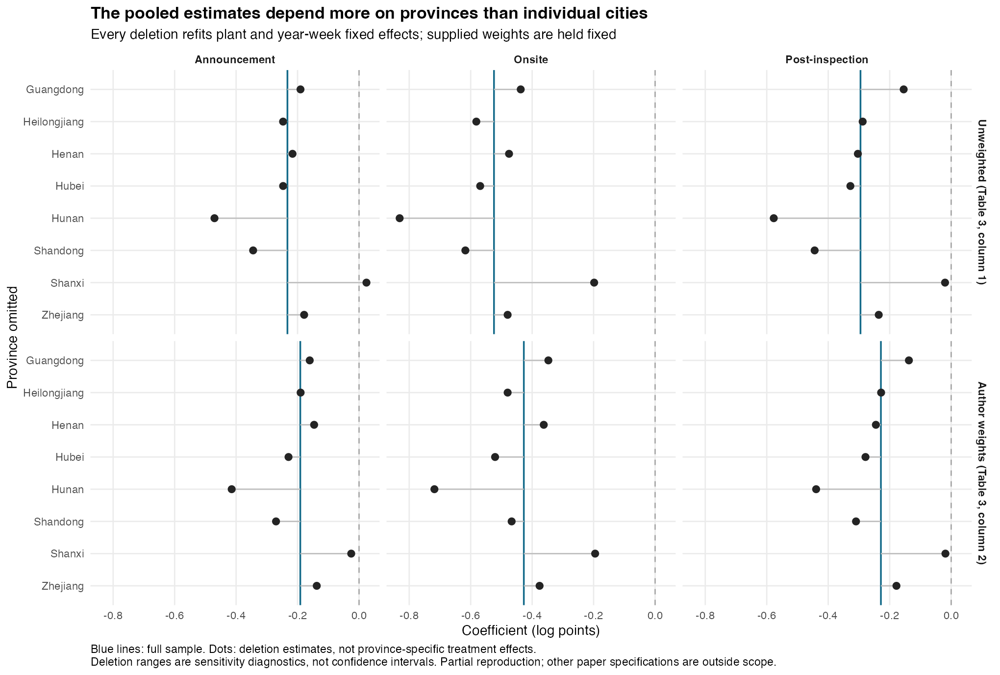

# 督察组离开之后：环保政策的效果能持续多久

[English](README.md) · [中文](README_ZH.md)

督察组进驻时，企业面临的监管压力会明显增加。更难回答的是督察结束之后：督察期间的空气改善能延续下去，还是会随着督察组离开而部分消退？

Karplus 和 Wu（2023）用中国中央环保督察研究这个问题。他们发现，督察期间燃煤电厂附近的二氧化硫污染下降，之后部分回升。我复现了其中四组主要模型，再检查平均效果在多大程度上取决于样本包含哪些地方。

[原文（PNAS）](https://pmc.ncbi.nlm.nih.gov/articles/PMC10151602/) · [作者数据与代码](https://doi.org/10.7910/DVN/AXWNCY)

## 主要发现

**复现结果一致。** 原文 Table 3 的四列中，我得到的估计值、标准误和样本量都与原表一致；模型拟合程度（R²）略有差别。

**督察期间污染下降的方向稳定，幅度不太稳定。** 逐一排除单个城市，结果几乎不变；逐一排除整个省份，下降幅度的估计变化明显，但每一次都仍然是下降。



*每个点表示排除左侧省份后重新得到的估计，蓝线表示全部样本的结果。*

## 尚待回答的问题

- **督察结束后的时期最不稳定。** 督察结束后第 6–10 周的估计，在排除某些省份后会改变正负号；而且只有八个省，支持“回升”的证据比较弱。这恰好是判断政策效果能否持续的关键部分，需要谨慎解读。
- **公告期同样敏感。** 不使用作者权重时，排除山西后，估计从污染下降变为上升。
- **R² 的差异尚未解释。** 我还没有找到原文使用的是哪一种定义。
- 我没有复现原文关于电厂隶属关系和政府监管层级的分析、Table 3 第 3 和第 6 列，也没有重新整理周度数据或重新估计样本权重。

<details>
<summary>展开：原文 Table 3 与本项目复现结果对照</summary>

以下数值直接取自仓库的[回归结果对照表](results/table3_comparison.csv)，均保留三位小数。括号内为标准误；系数以对数点计，不能直接读作百分比。第 1、4 列不加权，第 2、5 列使用作者提供的样本权重。

| 原表列号 | 时期 | 原文：估计值（标准误） | 本项目：估计值（标准误） |
|---|---|---:|---:|
| 1 | 公告期 | -0.233 (0.073) | -0.233 (0.073) |
| 1 | 督察期间 | -0.524 (0.093) | -0.524 (0.093) |
| 1 | 督察结束后 | -0.295 (0.100) | -0.295 (0.100) |
| 2 | 公告期 | -0.191 (0.092) | -0.191 (0.092) |
| 2 | 督察期间 | -0.427 (0.107) | -0.427 (0.107) |
| 2 | 督察结束后 | -0.229 (0.109) | -0.229 (0.109) |
| 4 | 公告期 | -0.209 (0.074) | -0.209 (0.074) |
| 4 | 督察期间 | -0.503 (0.094) | -0.503 (0.094) |
| 4 | 结束后第 1–5 周 | -0.409 (0.095) | -0.409 (0.095) |
| 4 | 结束后第 6–10 周 | -0.158 (0.110) | -0.158 (0.110) |
| 5 | 公告期 | -0.178 (0.093) | -0.178 (0.093) |
| 5 | 督察期间 | -0.417 (0.107) | -0.417 (0.107) |
| 5 | 结束后第 1–5 周 | -0.313 (0.111) | -0.313 (0.111) |
| 5 | 结束后第 6–10 周 | -0.135 (0.119) | -0.135 (0.119) |

14 个效果估计值及其标准误均与原文报告精度一致，四组模型的样本量也一致。R² 存在以下差异：

| 原表列号 | 原文观测数 | 本项目观测数 | 原文 R² | 本项目 R² |
|---|---:|---:|---:|---:|
| 1 | 42,309 | 42,309 | 0.766 | 0.769 |
| 2 | 31,582 | 31,582 | 0.739 | 0.741 |
| 4 | 42,309 | 42,309 | 0.768 | 0.772 |
| 5 | 31,582 | 31,582 | 0.741 | 0.743 |

R² 反映模型拟合程度。这一差异尚未解释，不能将上述数值吻合描述成整张表完全一致。[R² 核验记录](results/r_squared_audit.csv)比较了几种常见定义，均未在三位小数上与原文一致。本次范围为 Table 3 第 1、2、4、5 列。

原文存档覆盖 1,308 家电厂；不加权估计在去除不完整观测和单例组后保留 1,281 家电厂。表中的观测数为电厂—周观测数。

[地区排除检查](results/deletion_summary.csv) · [督察结束后的变化](results/attenuation_contrast.csv) · [完整数字与说明](docs/DETAILS.md)

</details>

## 运行方法

需要 R 4.6.0 和 Python 3.10+，R 包版本记录在 `renv.lock` 中。

```sh
Rscript setup.R
python3 run.py
```

数据下载至 `data/raw/`（已有本地数据时可用 `python3 run.py --offline`），结果写入 `results/`。作者数据通过 Harvard Dataverse 按 CC0 提供，本仓库不重新分发。
